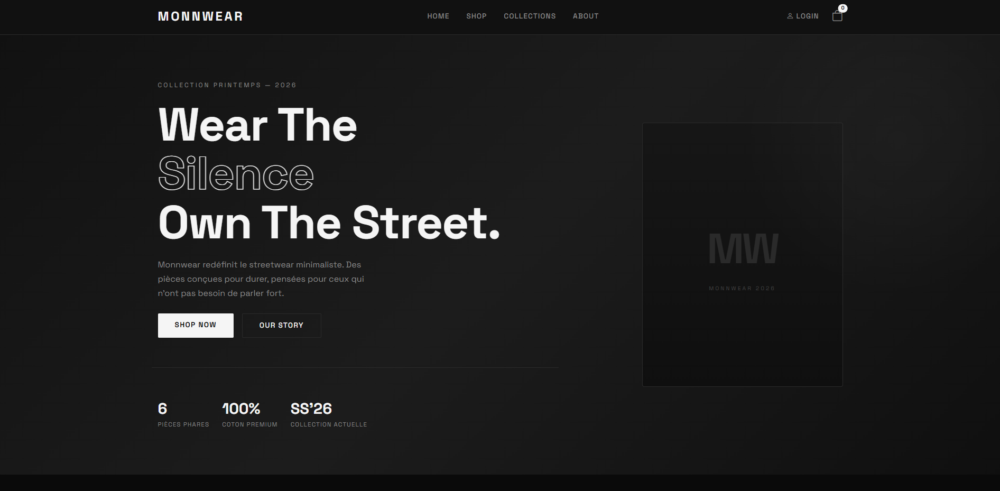
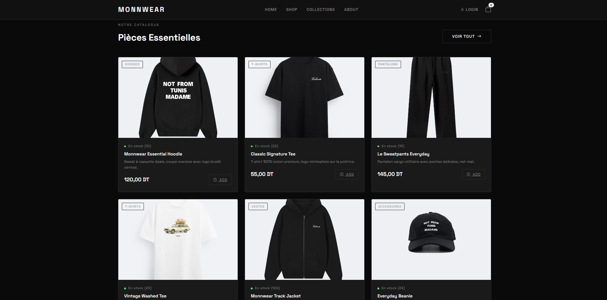
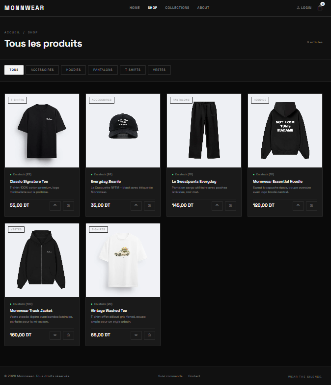
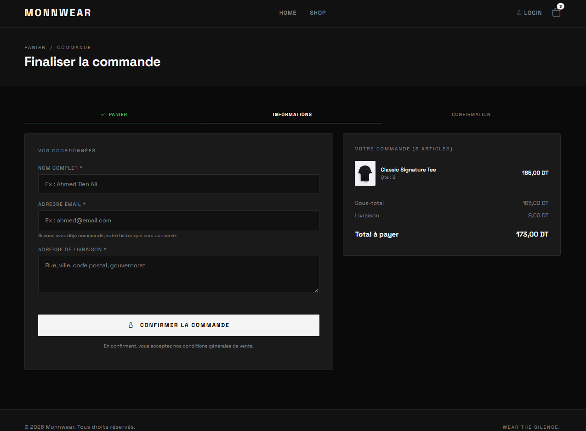
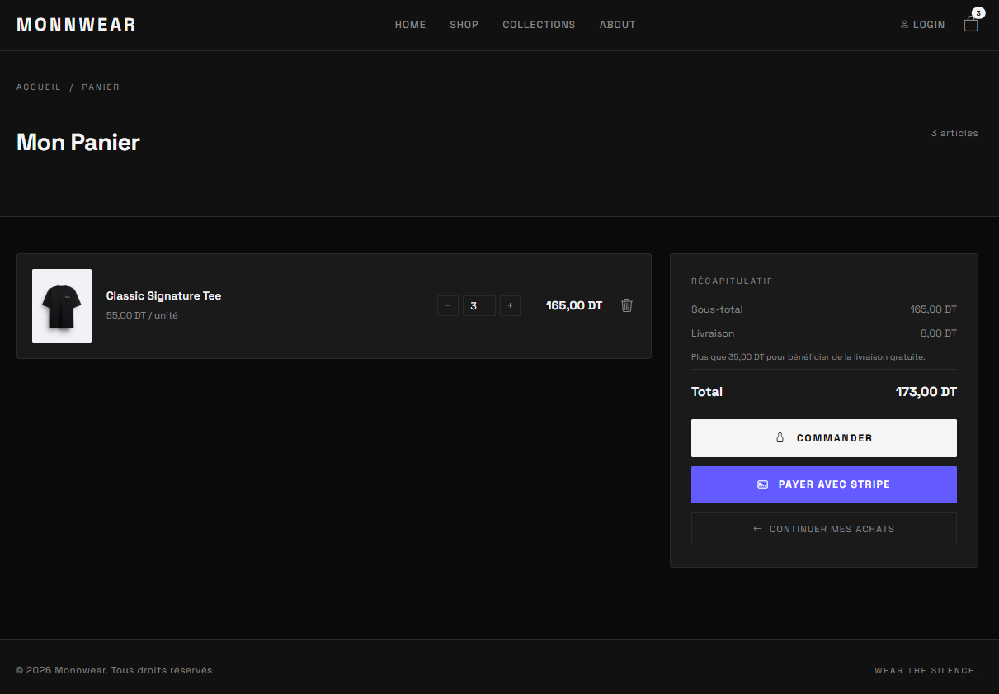
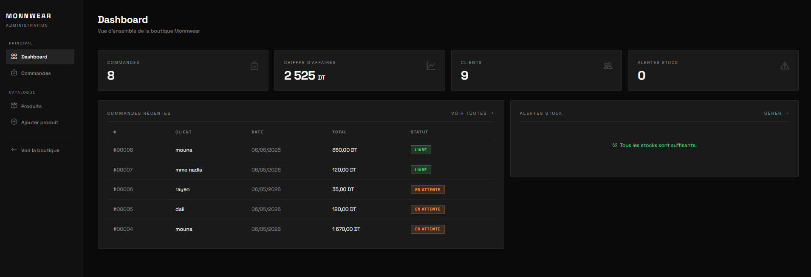

# MONNWEAR

### Full-Stack E-Commerce Web Application

<p align="center">
  A university project built to explore the development of a complete fashion e-commerce experience.
</p>

<p align="center">
  <strong>PHP</strong> · <strong>MySQL</strong> · <strong>PDO</strong> · <strong>HTML/CSS</strong> · <strong>JavaScript</strong> · <strong>XAMPP</strong>
</p>

---

## ✦ Overview

<p align="center">
  
  
</p>

> **MonnWear** is a minimalist streetwear e-commerce platform developed as a university project, combining a customer-facing storefront with a dedicated administration system.

MonnWear was built as a complete e-commerce experience rather than a simple static storefront.

The application covers the main journey of an online fashion store:

**Discover → Browse → Product → Cart → Checkout → Order**

Behind the customer experience, an administrative interface allows products and orders to be managed through a dedicated dashboard.

---

## ✦ Features

### Customer Experience

- Product catalogue and collections
- Product detail pages
- User registration and authentication
- Shopping cart
- Checkout workflow
- Order placement and confirmation
- Order tracking
- Promotional/product pricing support

### Administration

- Admin dashboard
- Product management
- Add products
- Edit products
- Order management
- Customer management
- Product promotion management

---

## ✦ Screenshots

### Shop and Product Details

<p align="center">
  
  
</p>

### Cart and Checkout

<p align="center">
  
  
</p>

### Admin Dashboard

<p align="center">
  
</p>

---

## ✦ Tech Stack

| Layer | Technology |
|---|---|
| Backend | PHP |
| Database | MySQL |
| Database Access | PDO |
| Frontend | HTML, CSS, JavaScript |
| Local Development | XAMPP |
| Version Control | Git & GitHub |

---

## ✦ Architecture

```text
                        MONNWEAR
                           │
              ┌────────────┴────────────┐
              │                         │
        Customer Side              Admin Side
              │                         │
        PHP Application             Admin Panel
              │                         │
              └────────────┬────────────┘
                           │
                          PDO
                           │
                           ▼
                    MySQL Database
```

The application uses PHP for server-side logic and PDO for communication with the MySQL database.

---

## ✦ Project Structure

```text
Monnwear_Project/
│
├── admin/
│   ├── add_product.php
│   ├── edit_product.php
│   ├── index.php
│   ├── orders.php
│   └── products.php
│
├── database/
│   └── monnwear_db.sql
│
├── docs/
│   └── images/
│
├── includes/
│   ├── db_connect.php
│   ├── navbar.php
│   └── update_clients_table.sql
│
├── index.php
├── shop.php
├── collections.php
├── product.php
├── cart.php
├── checkout.php
├── login.php
├── register.php
├── place_order.php
├── track_order.php
└── ...
```

---

## ✦ Database

The project uses a MySQL relational database.

The repository includes the database structure and SQL scripts required to recreate the local database.

```text
database/
└── monnwear_db.sql
```

Database access is handled through PDO, with prepared statements configured for safer database interaction.

---

## ✦ Running Locally

### Requirements

- XAMPP
- Apache
- MySQL
- PHP
- Web browser

### 1. Clone the repository

```bash
git clone https://github.com/mounasmiri/monnwear.git Monnwear_Project
cd Monnwear_Project
```

### 2. Place the project in XAMPP

Move the project into:

```text
C:\xampp\htdocs\
```

### 3. Start XAMPP

Start:

- Apache
- MySQL

### 4. Create the database

Open phpMyAdmin and create a database named:

```text
monnwear_db
```

Import:

```text
database/monnwear_db.sql
```

### 5. Configure the database connection

The local development configuration is located in:

```text
includes/db_connect.php
```

The default configuration is designed for a standard XAMPP MySQL setup.

### 6. Run the application

Open:

```text
http://localhost/Monnwear_Project/
```

---

## ✦ Admin Panel

Open:

```text
http://localhost/Monnwear_Project/admin/
```

---

## ✦ Payments

Checkout uses `create-checkout-session.php` to create a payment session. To test it locally, add your own test API keys. Never commit real keys to GitHub.

---

## ✦ Project Context

MonnWear was developed as a university project focused on building a complete full-stack e-commerce application for a fashion brand.

The project covers both the customer experience and the administrative side of an online store.

### What I Learned

Building MonnWear gave me hands-on experience with:

- Full-stack web development
- PHP application structure
- MySQL relational databases
- PDO database access
- Authentication and sessions
- CRUD operations
- Shopping cart and checkout logic
- Order management
- Admin dashboard development
- Database scripting
- Git and GitHub